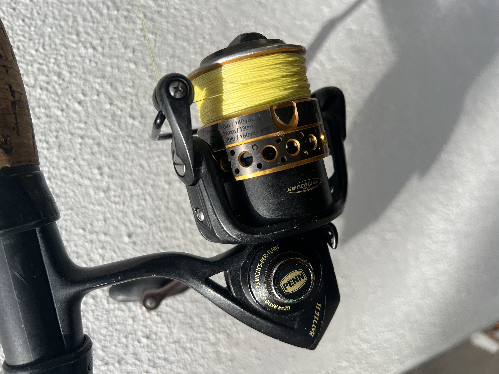

{width=50%}

For my first review I am reviewing my oldest inshore reel - the Penn Battle II 2500.  I purchased this reel in 2017 as a combo and considered it my first real inshore setup.  My idea, at the time, was to get one solid reel with available replacement parts that would last forever.  

Let me start by saying this reel has been fished harder than any other reel I own.  It has been dropped in the sand regularly from bank fishing.  It has been dunked no less than 5 times kayak fishing.  It has been knocked around, sprayed with salt water, and everything you can think of that would be considered abuse for a fishing reel.  

Let's cover the good things first.  The reel has served its purpose as a servicable workhorse.  It is pretty much bullet proof.  I have disassembled and regreased it 5-6 times over the years, mostly as a precautionary measure after trips when it was dunked.  I replaced 1 bearing due to my inexperience servicing reels, when I tightened a nut down too much and crushed the bearing housing.  Other than that, I haven't had to purchase any replacement parts.  

The drag on Penn reels is the best in the business.  It feels smooth, sounds great, and adjustments are dialed in  thanks to the wave spring construction.  I have yet to replace the carbon fiber drag washers, which are readily available if you ever need to.  I caught my biggest redfish with this reel: a 39 inch broad-shouldered monster  with 10lb braid and a 20lb leader.  The fight was at least 20 minutes with such light tackle, and it gave me 5 long, drag screaming runs.  The drag never slipped and applied consistent pressure throughout the fight.  Hundreds of fish have probably been caught on this reel, and the drag works good as new.

Next I'll cover the bail action, which I also believe is the best out of the big 3 reel manufacturers.  Flipping the bail open gives you a loud, positive click and feels like it is solidly in place - unlike the light mushy feeling of comparable Diawa reels.  The wire is thick and durable, and it has never slammed shut on me during a cast, which cannot be said for other brands. 

Now the bad. 

Wind knots.  This reel gets more wind knots than any reel I have owned.  I've heard the argument that wind knots are never the reel and always a technique problem.  Nonsense.  I don't get wind knots with any of my other reels at this frequency.  It is a unquestionably a design issue.  To mitigate this, you have to underspool the reel, which brings up my next negative:

Casting distance.  This reel does not cast great.  It's not bad, but I get less casting distance than my other reels of the same size.  This issue is compounded due to having to underspool it to prevent wind knots.

Weight.  This reel is heavy compared to its competition at 10.3 ounces.  It never really bothered me when it was my only inshore setup.  But as I aquired more gear, I noticed it is my heaviest 2500.  I fish 99% artificials, so I am casting all day.  If you use a lot of live or cut bait, this is not an issue.  Even on shorter trips with artificials, its not bad.  But on a 6 hour day, it will wear you out.  

So here's where I sit with the Penn Battle II 2500 - if you are hard on your gear or want a reliable, servicable reel that will last you forever, especially if you use a lot of live or cut bait, this reel is for you.  

If you are casting artificials all day on clear water flats where you need long, frequent casts, this will get the job done but may not be your best option.  

One last thing I'd like to note, which I concluded from owning this reel, is the industries over-emphasis on needing higher end models if you are hard on your gear.  They are constantly telling us if you dunk your gear you need IPX5 or IPX6 sealing, corrosion resistant coatings, etc.  It's not true.  This reel isn't IPX rated, and other than sealed bearings, doesn't have any special sealing features, and it keeps on trucking.  