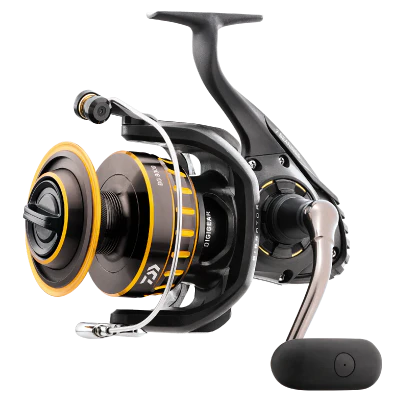

{width=50%}

There are lots of reviews on the Diawa BG.  It's a tried and true reel that is loved across the saltwater fishing community - particularly those looking for the most bang for their buck.  Most reviews are for larger sizes, so I'm going to cover the inshore size - the 2500.  I am sad to say I no longer own this reel - mine is now at the bottom of Mosquito Lagoon attached to a St. Croix Triumph rod.  This one hurt, as it was one of my favorite combos.  

Let's dive right into it.  It's an aluminum bodied reel with stainless steel bearings and a one piece handle with a paddle grip, which I prefer over other styles. It has a traditional bail wire, which I also prefer to Diawa's air bail. It clocks in at 9.3oz - on the heavier side for a 2500, but still an acceptable weight for a do-it-all inshore reel in my opinion.

I bought this reel for the purpose of dock fishing and heavier inshore applications, however I ended up using it as my primary artificial bait setup due to issues with the Diawa Fuego I had originally bought for that purpose.  

The BG has a lot going for it.  It feels super solid when you hook into a fish.  The carbon fiber drag works flawlessly. It's surprisingly smooth for a heavy duty reel.  I never had a single issue with this reel mechanically.  It just gets the job done and keeps on going.  Initially I was skeptical about buying a saltwater reel without sealed bearings. Fishing from a kayak, you are bound to dunk your reels at some point when you're leaning over the side to grab a fish.  I'm happy to report I dunked this reel twice, and it never had any issues.  I did not tear this reel down, clean, and regrease after it was underwater - it was only sprayed down with fresh water at the end of the trip.  

I did notice some arm fatigue after long days of casting artificials due to the weight.  Not enough so that it would be a deciding factor when purchasing a reel for this purpose, but it is something to note.  I'm also not a big fan of the bail action on the Diawa reels I have used.  When it clicks open, it doesn't feel locked into place like a Penn or even a Shimano, but that's a minor gripe.  Those are really the only negatives I can think of for this reel.  It's a solid reel and there's a reason its been in production for 10 years.  The only reason I did not replace the one I lost with the exact same reel was for the sake of trying new things.  I wanted to try a Shimano Spheros inshore, because I like testing out new gear.  

In short, the BG 2500 is one of the best inshore reels I have owned and is at the top of my list of favorites.  I will definitely be purchasing the new Diawa BG LT released this year to see if it lives up to the BG name.   Tight lines!