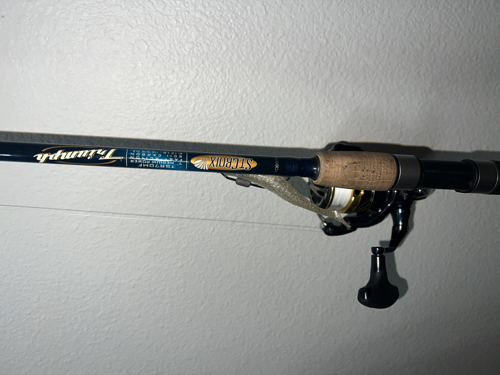

{width=45% .triumph-review-image}

This review is for the freshwater Triumph, although I use it almost exclusively for inshore fishing.  

I decided on this one over the inshore version because its line and lure ratings were a better match for what I'm using it for - artificial moving baits.  I wanted a fast tip, medium action rod where the tip was fast enough to get a solid hookset, but soft enough to keep trout pinned.  I previously fished rods on both ends of this spectrum, and they sometimes cost me fish.  
 
On paper, this rod doesn't look like anything special.  It's around $100, has Sea Guide aluminum oxide guides and a Sea Guide reel seat.  It has a full cork handle and the blank is built on St. Croix's SCII carbon fiber.  Nothing fancy.  But in your hands, there is something special about this rod.  It's more sensitive than it should be.  It balances great with every reel I have tried on it.  It's surprisingly light.  It casts great.  It does exactly what I bought it for - it gives good hooksets and has enough give to land softer strikes and fish with softer mouths.  The medium power is just right for an all-purpose artificial rod as well.  It's light enough for flats fishing, but strong enough to pull a fish away from the mangroves when needed (although I would opt for a medium-heavy if that was its primary use).
The reel seat is closer to the butt than most other 7ft rods, making it great for kayak fishing, especially if you fish with your life vest on.  I did not know this detail initially, but noticed it when my other 7ft rods would ocassionaly hit my life vest while fishing.  

The only negative I can think of is the hook keeper, and that is just preference.  It's a closed-style hook keeper and I prefer the open style.  My other complaint would be about St. Croix the company and not the rod itself.  I've dealt with their customer service twice, and both were bad experiences.  There is no communication what-so-ever, and it took 2 months to get a new rod from them.  No tracking numbers, no notifications, nothing.  Just getting someone to pick up the phone was a challenge.  Filing a warranty claim for a replacement rod will cost you $50-$60, which is half the price of this rod.  Between the wait time and the cost, you have to decide if the warranty is worth anything to you.

Even with my distaste for their customer service, I have purchased this rod 3 times now.  That speaks volumes about how much I like this rod.  I broke my first one (my fault), and the 2nd one fell off my kayak into the depths.  Everytime I go shopping for a new inshore rod, I am hard pressed not to buy another Triumph.  It continues to be my primary inshore rod because, well, there's really no room for improvement at this price point, and at $100-$130 I don't have to baby it.  

Highly recommended.  